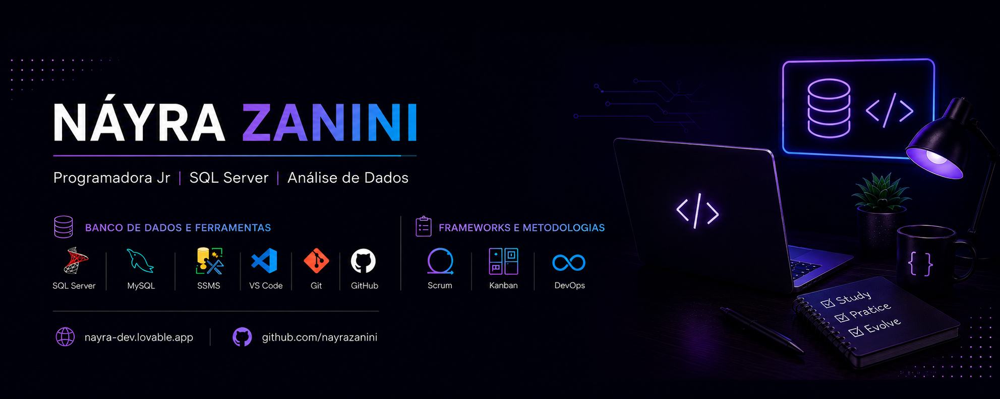

<h1 align="center">Olá! Eu sou a Náyra Zanini 👋</h1>

  <strong>Programadora Jr. • SQL Server • T-SQL • ERP Lyceum • Análise e Sustentação de Sistemas</strong>

  Analisando problemas, compreendendo regras de negócio e desenvolvendo soluções que conectam dados, sistemas e processos.

  <a href="https://nayra-dev.lovable.app/">Portfólio</a> •
  <a href="https://www.linkedin.com/in/nayra-zanini">LinkedIn</a> •
  <a href="mailto:zanini.n@outlook.com.br">E-mail</a> •
  <a href="https://instagram.com/nazanini_">Instagram</a>

---

# 👩🏻‍💻 Sobre mim

Sou **Programadora Jr.**, com experiência em sistemas corporativos, sustentação de ERP e banco de dados, atuando principalmente no ambiente educacional com o sistema **Lyceum**.

Trabalho com **SQL Server e T-SQL**, desenvolvendo e analisando consultas, realizando manipulação de dados e atuando na leitura, manutenção e ajuste de scripts, views e stored procedures. Também participo da investigação de inconsistências, análise de regras de negócio, testes funcionais e validação de alterações no sistema.

Minha experiência com o ambiente educacional me permite relacionar o comportamento do sistema aos processos que ele atende. No dia a dia, procuro compreender a solicitação, analisar os dados envolvidos, identificar possíveis causas e validar se a solução proposta atende à regra de negócio.

Sou graduada em **Administração com ênfase em TI** e em **Análise e Desenvolvimento de Sistemas**, além de pós-graduada em **Engenharia de Software**. Essa combinação entre formação e experiência prática fortalece minha visão sobre tecnologia, processos e necessidades do negócio.

Sou apaixonada por esportes, principalmente futebol, gosto de treinar na academia e adoro passar um tempo jogando online. Também não recuso um bom café e uma boa conversa. ☕

Hoje concentro minha atuação e meus estudos em:

- 📊 SQL Server e T-SQL
- 🗄️ Consultas, JOINs, subconsultas e manipulação de dados
- ⚙️ Stored Procedures, Views e análise de Triggers
- 🔎 Análise de Sistemas e investigação de inconsistências
- 🏢 ERP Lyceum e regras de negócio
- 🧪 Testes funcionais e homologação
- 📐 Modelagem de Banco de Dados e Engenharia de Software
- 🔄 Scrum, Kanban e melhoria de processos
- 🚀 Qualidade de Software e cultura DevOps

Meu objetivo é evoluir continuamente como profissional de tecnologia, ampliando minha capacidade de análise e desenvolvimento de soluções, sempre conectando conhecimento técnico, experiência prática e visão de negócio.

---

# 💡 Competências

### Banco de Dados e SQL Server

- Desenvolvimento de consultas SQL para análise e validação de informações.
- Utilização de JOINs, subconsultas, EXISTS, GROUP BY e filtros.
- Manipulação e conferência de dados.
- Leitura, análise e manutenção de Stored Procedures e Views.
- Análise de scripts, triggers e regras implementadas no banco.
- Investigação de inconsistências, conversões e divergências de dados.

### Análise e Sustentação de Sistemas

- Análise de solicitações e investigação de incidentes.
- Identificação de possíveis causas de problemas em sistemas.
- Compreensão de processos e regras de negócio.
- Análise de impactos de alterações em dados e rotinas.
- Testes funcionais, homologação e validação de resultados.
- Experiência com o ERP educacional Lyceum.

### Competências profissionais

- Pensamento analítico e resolução de problemas.
- Atenção aos detalhes e consistência das informações.
- Visão de negócio e compreensão de processos.
- Organização e documentação.
- Comunicação e colaboração com diferentes áreas.
- Aprendizado contínuo e busca por melhoria.

---

# 🚀 Tecnologias

### Banco de Dados

### Sistemas e Qualidade

### Ferramentas e Métodos

### Modelagem e Processos

---

# 📂 Projetos em Destaque

## 💰 Controle Financeiro Pessoal

Projeto de estudo desenvolvido para organizar informações financeiras e praticar a construção de uma solução aplicada a uma necessidade real. O projeto faz parte da minha evolução em desenvolvimento e da aplicação prática de conhecimentos de programação e lógica.

---

## ⏱️ Ponto SQL Server

Sistema para gerenciamento de registros de ponto utilizando SQL Server, com foco em consultas, procedures e regras de negócio.

---

## 📦 Estoque SQL Server

Projeto de controle de estoque desenvolvido em SQL Server, simulando operações reais de cadastro, movimentação e consultas.

---

## 📚 Study Planner SQL Server

Aplicação para organização dos estudos, acompanhamento de metas e evolução utilizando SQL Server.

---

# 🌐 Portfólio

Conheça meus projetos, experiências, estudos e certificações.

## Acesse

---

# 📖 Atualmente estudando

- SQL Server e T-SQL Avançado
- Consultas SQL, Stored Procedures e análise de desempenho
- Modelagem de Banco de Dados
- Engenharia de Software
- Arquitetura de Software
- Qualidade de Software e testes
- Análise de Sistemas e requisitos
- Scrum, Kanban e DevOps

---

# 🎓 Formação Acadêmica

- Administração com ênfase em Tecnologia da Informação — FIAP
- Análise e Desenvolvimento de Sistemas
- Pós-graduação em Engenharia de Software — UNIP

---

# 🏆 Certificações

- ✔️ Kanban Foundation Professional Certification (KBFC™)
- ✔️ Scrum Fundamentals Certified (SFC™)
- ✔️ Oracle Database Masterclass – Muito Além do SQL
- ✔️ Cursos complementares em SQL Server, Engenharia de Software e Tecnologia

---

# 📫 Contato

---

